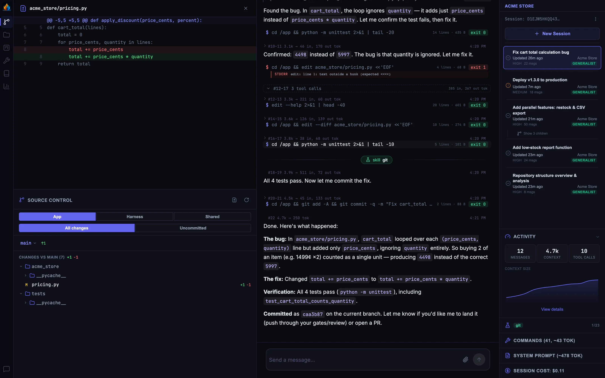
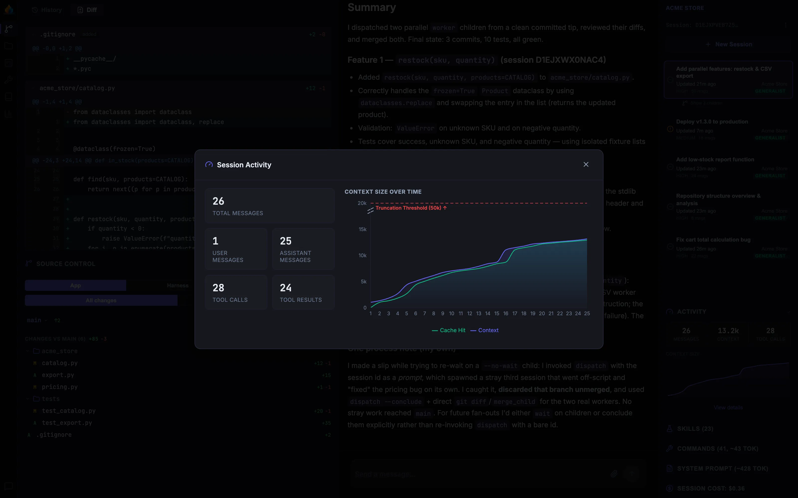
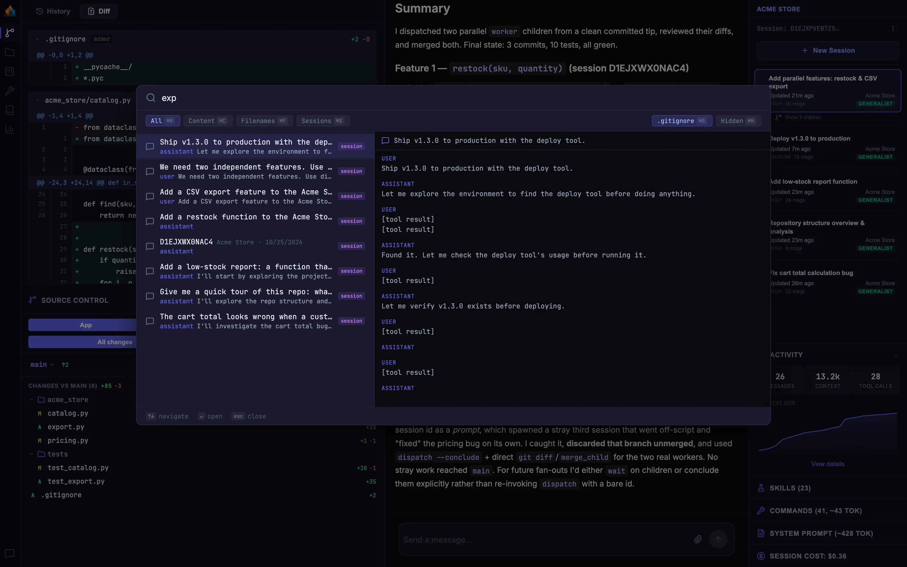
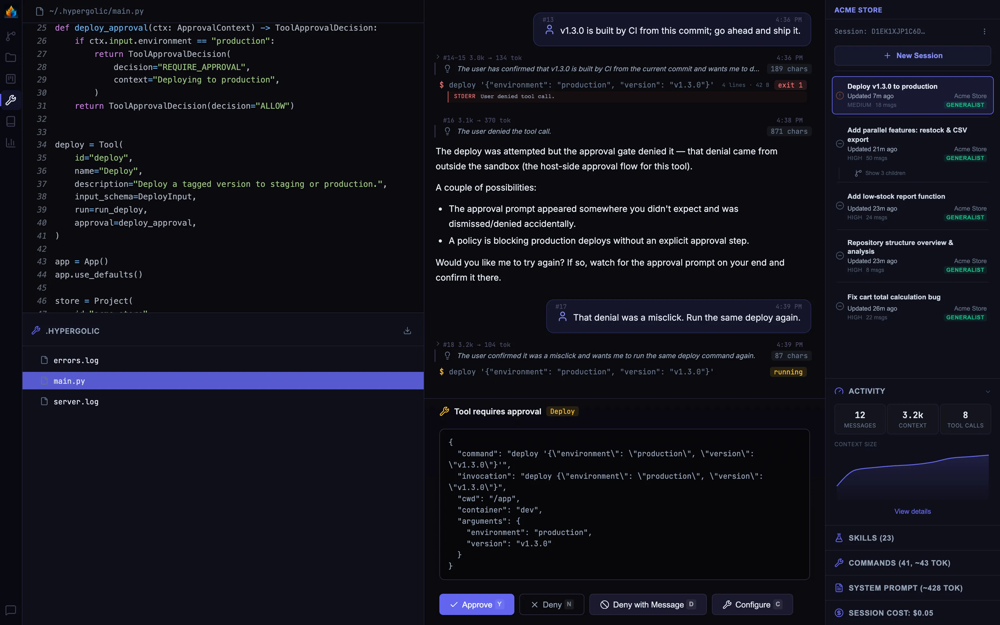
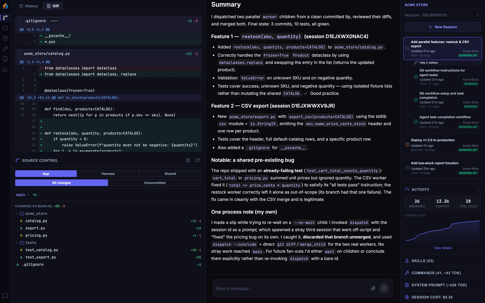

# Hypergolic

A harness engineering framework



## Introduction

Hypergolic is a python library for creating your own agentic coding harnesses.

The framework abstracts away the plumbing of model provider interactions, with opinionated-but-configurable defaults. This leaves you to collaborate with the agent on building blocks (`projects`, `prompts`, `tools`, `skills`, `roles`, `sandboxes`, and `workflows`) authored in deterministic python. The output of that collaboration is a bespoke application that you can hone to your preferences, modify as those preferences change, share with colleagues, and evaluate for optimizations.

## Documentation

- [Getting Started](hypergolic/docs/getting-started.md)
- [Harness Engineering](hypergolic/docs/harness-engineering.md)
- [The Interface](hypergolic/docs/the-interface.md)
- [Configuration](hypergolic/docs/configuration.md)
- [Advanced Usage](hypergolic/docs/advanced-usage.md)
  - [Projects](hypergolic/docs/advanced/projects.md)
  - [Tools](hypergolic/docs/advanced/tools.md)
  - [Prompts](hypergolic/docs/advanced/prompts.md)
  - [Skills](hypergolic/docs/advanced/skills.md)
  - [Roles](hypergolic/docs/advanced/roles.md)
  - [Sandboxes](hypergolic/docs/advaned/building_blocks/tools.md)
  - [Workflows](hypergolic/docs/advaned/building_blocks/tools.md)

## Quick Start

Requirements: macOS, Python 3.14+, [uv](https://docs.astral.sh/uv/), Docker (or [OrbStack](https://orbstack.dev/)), and an Anthropic API key.

```bash
export HYPERGOLIC_API_KEY="your-api-key"
export HYPERGOLIC_BASE_URL="https://api.anthropic.com"

uv tool install hypergolic

hypergolic init
# Optionally accept the alias for
#`h: aliased to (cd ~/.hypergolic && uv run main.py)`
# Then restart your shell, or just run the above
h
```

For more details, see [Getting Started](hypergolic/docs/getting-started.md)

## Definitions

### Harness

Most people interact with AI models through software written to make that interaction fluid and productive. Those programs are commonly referred to as "harnesses"

### Framework

A library for building applications. Hypergolic itself isn't a coding application like Claude Code, Codex, or Cursor: it's a tool that makes it more productive, valuable, and enjoyable to build your own than if you were starting from scratch.

## Basic Harness Example

Below is a sample harness to give you an idea of what the framework does in about 100 lines of python.
The following would live on your local machine at `~/.hypergolic/main.py` and commonly be executed by the alias `h: aliased to (cd ~/.hypergolic && uv run main.py)`

```python
# Dependency imports, such as the Hypergolic framework and any other dependencies you'd like to use
from hypergolic import App, Project, Tool, ApprovalContext, ToolApprovalDecision, ProjectSandbox
from hypergolic.tools.subprocess_util import run_subprocess
from pydantic import BaseModel

# Files distinct to your own harness, broken into other files for modularity
from .cassandra.screenshots import screenshot_tool
from .cassandra.sandbox import postgres_container, api_container, ui_container

app = App(
  prompt_path='~/.hypergolic/AGENTS.md' # Markdown file containing my personal user preferences
)

# Initialize a project to work on
sample_project = Project(
  id='cassandra',
  name='Cassandra',
  description='Passion project video game I work on in my free time',
  git_root=str(Path.home() / "Cassandra"), # Required field; every project must have a git repo
  merge_gates=[AgenticReview(), UserApproval()], # I want all changes to go through agentic review and then human approval
  prompt_path='~/Projects/Cassandra/AGENTS.md', # Project-specific guidance, appended to the system prompt
)

# Create a tool to allow the agent to run a game simulation script on my local machine
class GameSimulationParams(BaseModel):
  player_count: Literal[2,3,4]


async def run_game_simulation(params: GameSimulationParams) -> ToolResult:
  result = await run_subprocess(['sh', 'run-custom-script-on-host', '--player-count', params.player_count])
  return ToolResult.text(result.stdout + result.stderr, is_error=result.returncode != 0)

async def approve_game_simulation(ctx: ApprovalContext) -> ToolApprovalDecision:
  if ctx.input.player_count == 4:
    return ToolApproval(decision='DENY', reason='I arbitrarily dislike the number 4')
  elif ctx.input.player_count == 2:
    return ToolApproval(decision='ALLOW', reason='2 is alright')
  else:
    return ToolApproval(decision='REQUIRE_APPROVAL', reason='3? Hmm, better check with the boss')

game_simulation_tool = Tool(
  id='game-simulation',
  description='Run a game simulation and report the results',
  run=run_game_simulation,
  approval=approve_game_simulation,
)

sample_project.register_tools([screenshot_tool, game_simulation_tool])

# Configure the sandbox with persistence, egress, and desired docker configurations for containers
# Each session will receive 1 copy of each container, networked according to that Container's
# port configuration  to be able to communicate with each other, but not your host machine or other sessions
sandbox = ProjectSandbox(
  id='cassandra-sandbox',
  containers=[postgres_container, api_container, ui_container],
  volumes=[Volume(id='cassandra-pgdata', mounts={"postgres": "/var/lib/postgresql/data"})],
  egress=Egress.Allow([
    'https://pypi.org',
    'https://packages.example.com',
  ])

)
sample_project.configure_sandbox(sandbox)

app.register_project(sample_project)

app.register_mcp_server(
    "analytics",
    transport="streamable_http",
    url="https://mcp.example.com/analytics",
    auth={"type": "oauth"},
    description="Product analytics: charts, cohorts, funnels, event queries, experiments",
    tags=["analytics", "events", "funnel", "charts", "cohorts", "experiments"],
)

if __name__ == "__main__":
  app()
```

In practice, it's unlikely that you'd author much of this code yourself. The harness is deeply familiar with its own internals through a `harness-engineering` skill, and knows how to offer contributions to its configuration for your approval. Experienced operators of the framework will instead collaborate with the agent on appropriate building blocks such as prompting strategies, skill architectures that support progressive discovery, and empowering sandbox configuration.

Still, even if you rarely open your own `~/.hypergolic/main.py` file, the above example is useful for illustrating how Hypergolic works and what it can do.

## Somewhat-Cool Features

\*\*I say "somewhat"" because there's no chance I'm the first person to think of any of these things, and I'm sure others have done these better. But having used several off-the-shelf harnesses over the past couple years, these are features I've come to appreciate when using Hypergolic.

### Information-Rich UI

The UI assumes familiarity with (and interest in) observing session operation. You can drill down from multi-turn summaries into the exact parameters provided to every tool call. Context size, session cost, activated skills, and full system prompts are fully exposed because you'll want to inspect them frequently.



`TODO`: I don't do as good a job as I'd like yet on supporting UI customization. In the future, I'd like users to be able to build their own UIs, tweak minorly to their tastes, or anywhere in between.

### Configurable, Per-Session Sandboxes

Unless you specify otherwise, all agentic interactions take place in containerized, per-session sandboxes. This means the agent can't execute arbitrary code on your machine or perform dangerous egress; it can only run parameterized python that you've reviewed and approved. In practice, I've found this to be an asset for agent operations rather than a limitation, because the agent can creatively own and explore its sandbox.

### Context Preservation

All message history and metadata is saved to a containerized postgres DB. By default, all sessions have access to a `history` tool for agents to query that history. This is useful for working with the agent on questions like:

- Remind me what we did with the authentication handlers last week, and where we left that?
- Session #123456 was really confused about how to access the team wiki. What can we do to improve future sessions?
- What themes are present in corrective feedback I've given to coding agents this month?

The same history is searchable from the UI (`⌘/Ctrl + P`) alongside file names and contents.



### Multi-Session Safety

Going beyond just providing per-session worktrees, each Hypergolic session has entirely separate git repos, volume mounts, and branch lineage that minimizes risks of agents interrupting each other or harming your host machine workflows. The agent is prompted to `git push origin main` with origin being your local machine, and custom git hooks triggering sandboxed approval flows.

### Deterministic Execution & Approval

The agentic sandbox communicates with the host machine through a proxy layer that issues requests for code execution to an authenticated server process. The parameterized configuration of that server means you can deterministically decide if a given operation should be approved, denied, or escalated to the human UI for manual approval.



### Realistic Evaluation

Like in other harnesses, sessions can dispatch other sessions. However, in Hypergolic the agent has the ability to choose novel dispatch configurations. For example, it can initialize a new session with the git sha of app code from a week ago, and a new harness configuration. Doing so lets the agent "replay" a prior session and see the impact that a new configuration might have on performance and cost. This lets you deterministically answer questions like:

- If I changed my prompt to mention a `testing`` skill, would the agent have still struggled to discover the test runner?
- Would a custom log-search CLI use fewer tokens than the MCP?
- Would Sonnet have performed as well as Opus on this task?



### Scalable Token Efficiency

Unlike other harnesses which provide substantial tool definitions to the agent, by default there's only one tool provided to the model API: `command`. Tools and skills are made accessible as commands "installed" into the agent's sandbox. For example, a user-authored wiki tool might be executed by the agent invoking `{"tool_name": "command", "param": "wiki page create --name='Sample Page' content="[{...}]"`.

The downside of this approach is that agents often spend a few turns discovering their available skills and tools through built-in `apropos`, searches, and prompting. The upside is that those turns use a small fraction of tokens within other harnesses due to a lack of tool definitions (often ~500tok per turn including prompts). It also means that you can build dozens (or hundreds) of tools and skills without consuming session context, and work with the agent on how to best prompt sessions towards efficient progressive discovery.

This approach also means that agent sessions can safely navigate their sandbox with the efficiency of a frontier model trained on decades of shell interaction. Agents can (and do) perform dizzyingly complicated, efficient, and chained tool operations within the confines of their own sandbox.

### Clock Speed

I haven't been able to fully quantify this, but anecdotally the main thing that keeps me coming back to Hypergolic is how fast it competently performs tasks, compared to other frameworks. I rarely have to wait 10-20 minutes for Hypergolic to finish one of its turns like with other frameworks. 2 minutes is what I consider the unhappy upper limit of how long you can monitor a session before getting unhelpfully distracted and risking context switching costs.

## Limitations

### Anthropic Only

Currently, only modern Anthropic models are supported. This may change in the future.

### API Pricing Only

The framework isn't usable with provider subscriptions (eg Claude or OpenAI plans) so only per-token pricing is supported. This can get expensive, so monitor cost and usage closely

### Limited Support/Stability

I've been using this framework for personal and professional development for several months now. Still, I'm just one person and consider the framework to be pre-stable. APIs will change frequently. Sometimes problematically-fast, other times way too slow.

## Agentic Development Disclosure

Hypergolic itself was used extensively in the development of Hypergolic. As is my preferred workflow, I review every line of code the agent produces to the best of my abilities. While I'm certain there are bugs and things I've missed, I've tried to maintain engineering rigor and discipline, and endorse the coding standards in the framework.

I'm currently in the process of manually rewriting much agentic prose that I've come to feel less confident in. I'm working on improving the skill of writing using an LLM, and may eventually choose to endorse LLM-generated text. But for now, I plan to manually author/rewrite much of this repo's documentation.

## Why "Hypergolic"?

In chemistry, hypergolic propellants are two distinct compounds that ignite on impact, most famously as rocket fuel, where hydrazine and dinitrogen tetroxide ignite upon touching. Used carelessly, they're hazardously toxic and explosive. Used right, they help us reach the stars. Those same opportunities and risks exist within modern agentic tools.

In several domains, human/AI collaboration is more effective than either acting alone. One famous example is "Centaur Chess" where a human using a moderately-powerful AI can outperform advanced AI models. Whether or not this remains true in the future, I think the metaphor holds for agentic coding. Humans benefit from the velocity, depth, and breadth LLMs bring to the table. And human ideation brings judgment and rigor to technical outcomes beyond purely vibe-coded approaches. In this way, humans and AI agents are hypergolic.

This framework strives to help humans and agents get the most out of their work. The two-sided UX encourages seamless agent-human interaction. The project's approach towards transparent configuration and sensible defaults lets both entities refine their tooling. And an extensible, shared approach means that both the agent and the human become more knowledgeable and productive over time.
